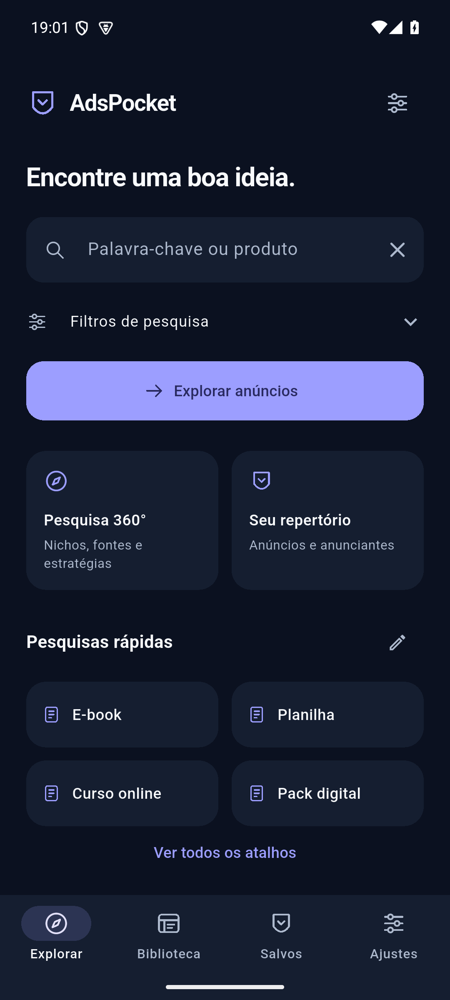
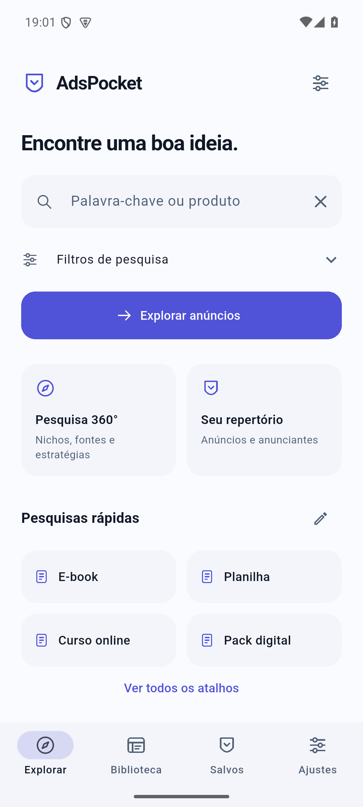
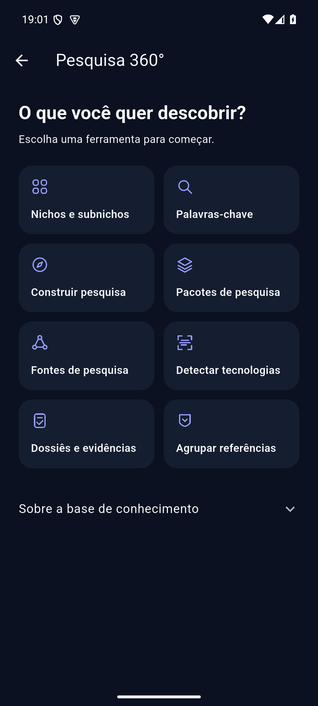

# AdsPocket

Pesquisa de anúncios e mineração de ofertas no celular. Aplicativo Android em Flutter, gratuito, sem conta, sem backend e sem afiliação à Meta. Mostra a Biblioteca de Anúncios oficial num navegador integrado otimizado para uma mão e organiza localmente o que você encontra.

**Versão 1.2.0** · [Funcionalidades](FEATURES.md) · [Arquitetura](ARCHITECTURE.md) · [Validação](TESTING.md) · [Limitações](KNOWN_LIMITATIONS.md)

  

Capturas reais do emulador Android 15 em 29/10/2026, com banco isolado de QA. [Design](docs/DESIGN.md) · [Validação](TESTING.md).

## Instalar

O APK **não fica no Git** (`dist/` é ignorado). Opções:

1. **Build local**: `flutter build apk --release --target=lib/main.dart` → `build/app/outputs/flutter-apk/app-release.apk`. Nesta máquina, a cópia validada está em `dist/AdsPocket-1.2.0.apk` (SHA-256 em `dist/SHA256-1.2.0.txt`).
2. **GitHub Actions**: o workflow `.github/workflows/android.yml` gera o artefato `AdsPocket-apk` em cada push na `main` e cria um **rascunho** de release para tags `v*`. O estado remoto do CI não foi consultado nesta rodada; nenhuma publicação foi executada por esta entrega.

No celular, abra o APK e permita a instalação pelo gerenciador de arquivos.

**Atualizar a partir da 1.0.0/1.1.0**: o APK local 1.2.0 usa a mesma chave da 1.0.0 e instala por cima, preservando favoritos, histórico e ajustes; migração aditiva coberta por testes. APKs do CI sem os secrets de assinatura usam outra chave e exigem desinstalar antes. Veja [Assinatura](#assinatura).

## Pesquisa 360°

Em **Explorar → Pesquisa 360°**, escolha um nicho/subnicho, consulte palavras-chave ou construa uma pesquisa. Salve pacotes reutilizáveis, abra fontes oficiais, registre detecções como evidências e relacione anúncios em dossiês. A fase 1 funciona localmente; fontes externas são navegação assistida. Base: transcrição fornecida, sem conferência dos PDFs originais. [Método](MINING_METHODOLOGY.md) · [Base](MINING_KEYWORDS.md) · [Roadmap](ROADMAP.md) · [Changelog](CHANGELOG.md).

## Uso rápido

1. **Explorar**: digite a palavra-chave e abra **Filtros de pesquisa** para ajustar: país, ativos (padrão) ou todos, mídia (todas/imagem/vídeo), **ativos há X dias** (padrão 14) e **quantidade de anúncios ativos** com o mesmo criativo. Dias e quantidade aceitam valores prontos ou **Personalizado…**.
2. **Biblioteca** (resultados oficiais da Meta), com o assistente ligado:
   - cada card ganha uma barra de ações: **Salvar**, **Página**, **Copiar link**, **Compartilhar** e o selo "N DIAS · M ANÚNCIOS";
   - os cards mais novos que o filtro ficam ocultos;
   - o cabeçalho e a barra mostram **quantos anúncios a Meta exibe** (ex.: ~19,000), quantos foram carregados e quantos passaram no filtro.
3. Barra do assistente: **dias** (ex.: 14+ ou qualquer número até 365), **quantidade de anúncios** (2+, 3+, 5+, 10+, 20+ ou personalizado; é o "N ads use this creative and text" que a Meta mostra no card) e **Auto-rolar**, que rola sozinho até achar mais N anúncios no filtro (padrão 20). O selo do card mostra, por exemplo, "37 DIAS · 24 ANÚNCIOS".
4. **Salvar** no card guarda o anúncio já preenchido: Library ID, anunciante, data de início, status, texto, link de vendas, variações. O aviso oferece **Comentar** (comentário e tags), opcional.
5. **Página** no card abre todos os anúncios ativos daquele anunciante (como no PC). O app lê o Page ID em "Ver detalhes do anúncio › Sobre o anunciante"; quando a Meta não mostra o ID ali, ele digita o nome na busca da Meta e destaca o anunciante certo, e você só toca nele. Também dá para digitar o nome no campo da Meta e escolher em **Anunciantes**. O botão **Salvar** da toolbar guarda o anunciante com o Page ID e a contagem que a Meta mostra na Página.
6. **Modo Feed** (Mais opções › Feed): só os anúncios, como num feed de rede social. Some a interface do app; as barras fixas da Meta passam a rolar com a página; um controle flutuante (Voltar, Filtros, Auto-rolar, Sair) se esconde ao rolar para baixo.
7. **Salvos**: Anúncios | Anunciantes | Outros. Busca, idade, preço low ticket, revisão rápida (Descartar/Observar/Interessante, com desfazer) e comparar (toque longo em dois).
8. **OCR** continua disponível: compartilhe um print → *Analisar imagem*.

O assistente pode ser desligado em **Ajustes → Assistente da Biblioteca**. Se a Meta exigir login, verificação ou bloquear o WebView, use **Abrir no navegador**.

## Compilar

Flutter **3.47.2**, Dart 3.13.2, Java 21, Android SDK com API 36. Android mínimo: API 24.

```powershell
flutter pub get
flutter run -d <dispositivo>
flutter build apk --debug --target=lib/main.dart
flutter build apk --release --target=lib/main.dart
```

Se o Java 21 não for detectado no Windows: `$env:GRADLE_OPTS = '-Dorg.gradle.java.home="C:\caminho\jdk-21"'`. Rode comandos Flutter em sequência (análise, `pub get` e builds simultâneos podem regenerar o registrador de plugins).

## Testes

```powershell
dart format --output=none --set-exit-if-changed lib test integration_test test_driver
flutter analyze
flutter test
bash tool/android_tests.sh integration_test/app_test.dart emulator-5554
bash tool/android_tests.sh integration_test/live_meta_test.dart emulator-5554
```

Resultados da 1.2.0 em [TESTING.md](TESTING.md). A execução live com anúncios reais registrada na 1.1.0 é mantida como evidência histórica. Aparelho físico ainda não testado. Detalhes em [TESTING.md](TESTING.md).

## Assinatura

- **Sem variáveis**: release assinado com a chave de debug local (uso pessoal; a mesma da 1.0.0).
- **Produção**: defina `ADSPOCKET_KEYSTORE`, `ADSPOCKET_KEYSTORE_PASSWORD`, `ADSPOCKET_KEY_ALIAS`, `ADSPOCKET_KEY_PASSWORD`. No GitHub, crie os secrets `ADSPOCKET_KEYSTORE_BASE64` (keystore em base64), `ADSPOCKET_KEYSTORE_PASSWORD`, `ADSPOCKET_KEY_ALIAS` e `ADSPOCKET_KEY_PASSWORD`. Nunca versione keystores ou senhas.
- Trocar de chave exige desinstalar uma vez. Use sempre a mesma chave depois disso.

## Privacidade

Pesquisas, favoritos, Mineração, imagens e textos de OCR ficam na área privada do app. O OCR roda no aparelho (Google ML Kit, modelo embarcado). O assistente lê apenas o texto visível dos cards na sua tela; o app não lê cookies, senhas ou tokens, não usa APIs privadas e não contorna verificações da Meta. Backups JSON/CSV são gerados só quando você escolhe o destino.

## O que o app não faz

Não conta anúncios por conta própria (mostra a contagem exibida pela Meta), não monitora Páginas em segundo plano, não estima vendas, não baixa mídia protegida e não aplica os filtros de idade/preço à Biblioteca remota. Veja [KNOWN_LIMITATIONS.md](KNOWN_LIMITATIONS.md).
